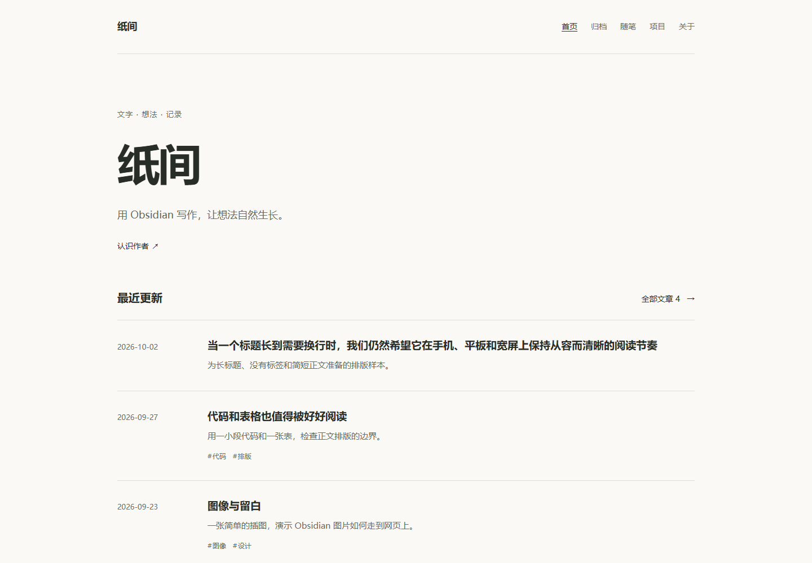

# Obsidian Blog Starter

在 Obsidian 中写作，用 Git 管理内容，把明确公开的笔记变成自己的博客。

这是一个可独立部署、可自由换前端的起点：Spring Boot 负责内容同步与公开 API，MySQL 保存发布结果，Redis 提供同步锁，默认页面使用 Thymeleaf。仓库自带公开示例 Vault、Docker Compose、中文部署文档和不依赖框架的 JavaScript 客户端。



## 快速开始

本地只需 **Git 与 Docker Compose v2**，Docker 必须已启动。不需要安装 Java、Maven、Node，也不需要 Obsidian 或 GitHub 账号。首次构建需要联网下载镜像和 Maven 依赖，耗时取决于网络。

先克隆仓库并进入目录：

```sh
git clone https://github.com/vansye/obsidian-blog.git
cd obsidian-blog
```

然后执行：

**Windows PowerShell**

```powershell
powershell -ExecutionPolicy Bypass -File .\scripts\setup-demo.ps1
```

**macOS / Linux**

```sh
sh scripts/setup-demo.sh
```

打开 **http://localhost:8080**。脚本会生成本机随机凭据、把 `example-vault` 复制到 `data/vault`、建立独立 Git 仓库并提交，然后执行 `docker compose up --build -d --wait`。数据库由 Flyway 自动初始化。

脚本**拒绝覆盖已有 `data/vault`，也不会覆盖已有 `.env`**。已有数据时，直接用下面命令启动：

```sh
docker compose up --build -d --wait
```

可用 `-PrepareOnly`（PowerShell）或 `--prepare-only`（Shell）只生成演示文件，稍后再启动容器。若 8080 已占用，修改 `.env` 中的 `PORT`，并同步调整 `SITE_URL`。

## 在 Obsidian 里发布第一篇文章

把 `data/vault` 作为 Vault 打开，在 `博客/文章/` 新建 Markdown：

```markdown
---
publish: true
title: 我的第一篇文章
slug: hello-world
created: 2026-10-09
description: 在这里写一句摘要。
tags: [写作, 学习]
---

你好，这是我的第一篇文章。
```

保存后提交到这个 Vault 的 Git 仓库：

```sh
git -C data/vault add .
git -C data/vault commit -m "Publish my first post"
```

演示配置每 5 秒检查一次。访问 `/p/hello-world` 即可看到文章。**只读取 Git 已提交的内容**，未提交修改不会发布。可在 Obsidian 中使用自己的 Git 工作流，插件不是必需条件。

文件布局固定如下，`PUBLISH_ROOT` 可以把最外层的“博客”换成其他仓库相对目录：

```text
data/vault/
├── 博客/
│   ├── 文章/          → /archive
│   ├── 随笔/          → /notes
│   ├── 项目/          → /lab
│   ├── _assets/       → 被公开文章引用的图片
│   ├── 关于.md        → /about
│   └── 友链.md        → /about 内的友链
├── 个人/              → 永不发布
└── 日记/              → 永不发布
```

发布需要同时满足路径在白名单内、Markdown 合法、`publish: true` 为布尔值。`个人/`、`日记/` 根目录，以及任意层级的 `草稿/`、`_模板/`、`素材/` 目录会被排除。缺少 `publish`、设置 `publish: false`、移出发布范围或删除后再次提交，都会在下次同步撤下相应内容。

仅用于私下备忘的内容建议始终留在排除目录。样例中的私密文件是虚构测试内容。图片只有仍被当前公开文章引用时，公开地址才可访问。

## Markdown 支持范围

- 支持标题、列表、引用、代码块、GFM 表格、删除线和任务列表。源 HTML 会转义。
- 图片推荐使用完整仓库路径：`![[博客/_assets/demo.svg|图片说明]]`。仅写文件名时，从文章所在目录的 `_assets` 子目录查找。发布图片需同时 Git 提交。
- `[[笔记|别名]]` 显示为普通文字；Markdown 笔记嵌入不会被展开成公开内容。不支持 Obsidian 插件、Dataview、Canvas 或 `../` 图片路径遍历。
- 图片公开地址为 `/assets/{内容哈希前16位}.{扩展名}`，不暴露原始 Vault 路径。SVG 响应使用限制性 CSP。
- frontmatter 支持 `publish`、`title`、`slug`、`created`、`updated`、`description`、`tags`。日期使用 `YYYY-MM-DD`。标题缺省取正文首个标题或文件名，摘要缺省从正文提取，日期缺省使用 Git 历史。
- `slug` 必须唯一，长度 1–128，使用小写英文、数字及中间的单个连字符，如 `hello-world`；非法值不会发布。缺少或留空时使用后端生成的 `plate`，前端始终读取 `canonicalPath`。重名 slug 的内容不会覆盖已发布文章，详情见同步日志。

## 修改站点和前端

编辑 `.env` 的 `SITE_NAME`、`SITE_DESCRIPTION`、`SITE_AUTHOR`、`SITE_URL`，可选 `SITE_GITHUB`、`SITE_EMAIL`，然后执行 `docker compose up -d` 应用环境变量变更。

默认主题集中在 `app/src/main/resources/static/css/site.css`，使用颜色、字体、字号、间距及阅读宽度 CSS 变量。页面位于相邻的 `templates/`。修改后执行 `docker compose up --build -d --wait`。

想让 AI 换成自己的设计，直接从 [前端 AI 改造指南](docs/FRONTEND_AI.md) 复制提示词。可选择原地改 Thymeleaf，或用 React、Vue、Astro、纯 HTML 等独立前端接入。完整接口见 [OpenAPI](docs/openapi.yaml)，静态样本见 [fixtures](docs/fixtures/README.md)。

以下截图仅展示原个人站点的视觉效果，作为定制方向参考；仓库实际交付一套默认主题。截图不代表交付第二套主题，也不授予复用其中原站设计、图片或其他素材的许可：


仓库包含可直接运行的独立纯 HTML 示例；此项开发体验额外需要 Node.js 20+：

```sh
node examples/plain-frontend/server.mjs
```

打开 http://127.0.0.1:5173。示例开发服务器把 `/api/v1/` 和 `/assets/` 转发到本地后端，不需要配置 CORS。设置 `BLOG_BACKEND` 可更换后端，`FRONTEND_PORT` 可更换端口。

## 检查与维护

演示服务运行后，可验证页面、API、排版和排除规则：

```powershell
powershell -ExecutionPolicy Bypass -File .\scripts\verify-demo.ps1
```

```sh
sh scripts/verify-demo.sh
```

常用命令：

```sh
docker compose ps
docker compose logs --tail=100 app
docker compose stop
docker compose up -d --wait
```

`docker compose down` 停止并移除容器，但保留 MySQL/Redis 命名卷与 Vault。`down -v` 会删除数据库卷，不应作为普通重启命令。数据库卷建立后，仅修改 `.env` 的数据库密码不会修改数据库内已有账号密码。

开发测试（额外需要 Java 17 / Maven，客户端测试需要 Node.js）：

```sh
mvn -f app/pom.xml test
mvn -f app/pom.xml -Pintegration verify
node --test client/blog-client.test.mjs examples/plain-frontend/server.test.mjs scripts/test-setup.mjs
```

集成测试需要可用的 Docker。安装 Maven/Java 是开发者选择，不影响 Docker 演示启动。

当前执行结果与验证边界见 [复现验证记录](docs/VALIDATION.md)。

## 连接自己的 Vault 和服务器

本地编辑模式保持 `SYNC_FETCH_ENABLED=false`，通过宿主机提交更新，Vault 在容器内只读。

生产推荐：服务器独立完整克隆 Vault 仓库，使用只读 GitHub Deploy Key，启用 `compose.production.yaml`，通过定时拉取或签名 Webhook 更新。拉取仅执行 `fetch --prune origin` 和 `merge --ff-only @{u}`，不会强制 reset。默认端口绑定 `127.0.0.1`，可在同机配置 HTTPS 反向代理。

详细操作、备份、Webhook 与故障排查见 [部署指南](docs/DEPLOYMENT.md)。每个 Vault/数据库只运行一个应用实例。

## 目录与许可证

| 目录 | 用途 |
| --- | --- |
| app/ | Java 后端、数据库迁移与默认 Thymeleaf 页面 |
| example-vault/ | 可公开示例内容 |
| scripts/ | 初始化、演示检查与脚本保护测试 |
| client/ | 无依赖 JavaScript 公共 API 客户端 |
| examples/plain-frontend/ | 独立前端与本地代理示例 |
| docs/ | OpenAPI、AI 指南、部署、接口样本与截图 |
| data/、secrets/、.env | 本机生成，均被 Git 忽略 |

项目原创代码和示例内容使用 [MIT License](LICENSE)。第三方依赖保留各自许可，见 [THIRD_PARTY_NOTICES.md](THIRD_PARTY_NOTICES.md)。
